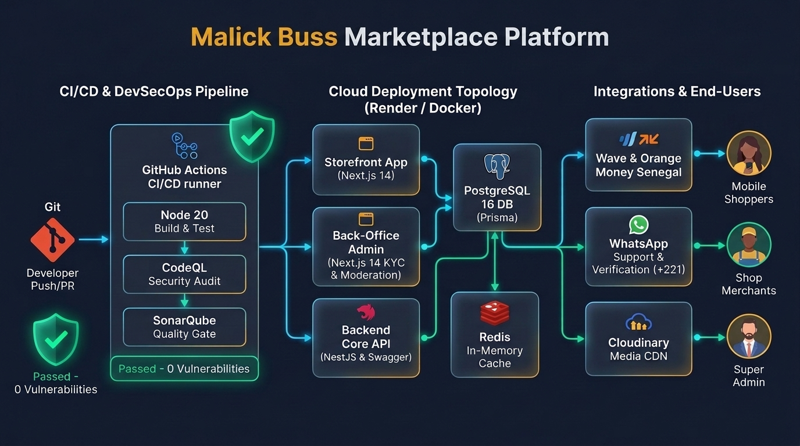
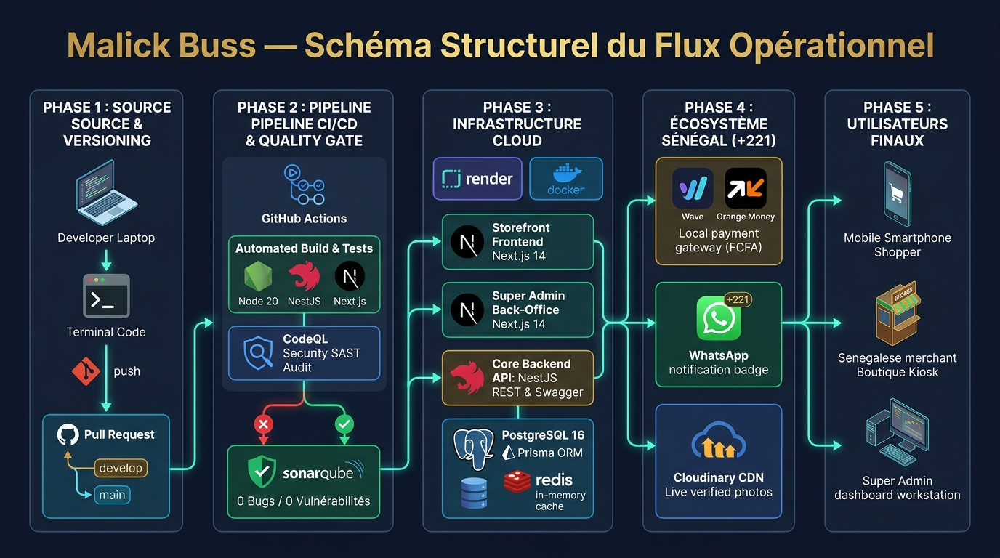

# 📚 Portail Documentaire Entreprise — Malick Buss

Bienvenue sur le centre de documentation officiel de la plateforme e-commerce multi-boutiques **Malick Buss (Sénégal)**.

---

## 📑 Répertoire des Livrables Techniques

| Document | Format | Description |
| :--- | :---: | :--- |
| **[Dossier d'Architecture & Manuel d'Exploitation](main.pdf)** | **PDF (17 pages)** | **Dossier de référence complet** : Spécifications techniques, modèles relationnels, matrice des use cases Super Admin, sécurité, CI/CD et exploitation. |
| **[Code Source LaTeX du Dossier](main.tex)** | **LaTeX** | Fichier source de la documentation d'entreprise, compilable via `pmt_domentation`. |
| **[Guide Déploiement Hybride Render + Vercel](deployment/render-vercel-deployment.md)** | **Markdown** | Procédure pas-à-pas pour déployer le Backend sur Render et les Frontends sur Vercel. |
| **[Guide CI/CD Render](deployment/cicd-render.md)** | **Markdown** | Configuration du pipeline de promotion continue Staging et Production. |
| **[Guide SonarQube & Qualité de Code](sonarqube-guide.md)** | **Markdown** | Paramétrage du serveur SonarQube local (Docker) et du Quality Gate GitHub Actions. |
| **[Catalogue des Ressources Graphiques](assets/README.md)** | **Assets** | Schémas d'architecture et captures d'écran de l'application. |

---

## 🎨 Schémas d'Architecture & Infographies Officielles

### 1. Architecture Globale Cloud & CI/CD


### 2. Schéma Structurel du Flux Opérationnel (5 Phases)


---

## 🛠️ Commandes Documentaires (`pmt_domentation`)

Le projet intègre le paquet de standardisation documentaire `pmt_domentation` avec les commandes npm suivantes :

```bash
# Vérifier l'outillage système (Docker, LaTeX, Silicon, Python)
npm run doc:doctor

# Générer les captures de code stylisées via silicon
bash scripts/generate-code-captures.sh

# Recompiler le dossier technique complet en PDF (17 pages)
npm run doc:build

# Nettoyer les fichiers temporaires de compilation
npm run doc:clean
```

---

*Direction Technique Malick Buss — Document certifié conforme pour exploitation en production.*
